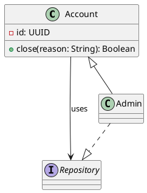

# E3-E2: conversión del subconjunto PlantUML de clases

Base aceptada: E3-E1, commit `96e8e98` en `codex/e3-e7-product`. Fuente normativa: [A3_ESPECIFICACION_MAESTRA.md, §§13.3 y 14.1–14.3](../../A3_ESPECIFICACION_MAESTRA.md); spike [E0-D2](../e0/compatibility/diagram-engines.md); semántica UML A3 de [E3-B1](e3-b1-uml.md) y [ADR 0014](../adr/0014-uml-class-semantics.md).

## Comportamiento

«Previsualizar conversión a UML A3» lee una fuente `.puml` o `.plantuml` interna del proyecto, muestra los clasificadores y relaciones convertibles, el mapa de IDs, la acción prevista (crear, actualizar, sin cambios o conflicto), las construcciones omitidas y los includes/recursos que este adaptador no resuelve. No lee montajes, no sigue includes, no descarga URLs ni ejecuta directivas, macros, scripts o plugins. El parser es puro y acotado; no llama al renderer PlantUML.

El Resource PlantUML sigue siendo la copia canónica byte por byte. La vista previa y el comando de aplicación fijan revisión y SHA-256 de la fuente. Si cambian antes de aplicar, la operación se rechaza y conserva ambas versiones. La primera aplicación crea registros UML con claves de procedencia `a3.plantuml.import`. La actualización requiere ese origen y el mapa de IDs persistido; siempre vuelve a producir un diff. Los elementos que desaparecen quedan reportados como claves obsoletas y no se borran automáticamente. Una construcción renombrada recibe una identidad nueva; el diálogo no adivina equivalencias ni ofrece reasignación manual aún.

Aplicar ofrece dos acciones explícitas: conservar la autoridad `source` o cambiarla a `a3-model`. La edición posterior del modelo A3 no reescribe ni regenera PlantUML. La fuente completa permanece disponible después de ambas acciones. Un import parcial puede aplicarse luego de revisar las líneas no convertidas; los conflictos de identidad, colisiones de IDs, familia desconocida o mapeo inválido bloquean la aplicación.

## Gramática admitida

Un documento tiene exactamente un bloque con delimitadores en líneas solas `@startuml` y `@enduml`. Los nombres son identificadores ASCII simples (`[A-Za-z_][A-Za-z0-9_]{0,63}`); se comparan sin distinguir mayúsculas para detectar colisiones. Las relaciones pueden crear un clasificador implícito `class`; una declaración explícita posterior puede precisarlo como `class` o `interface`.

| Construcción | Forma exacta que convierte | Modelo A3 |
| --- | --- | --- |
| Classifier | `class ID`, `interface ID`; una declaración puede abrir un compartimento con `{` en esa línea y cerrarlo con `}` en otra. | `a3.uml.class` o `a3.uml.interface`; las relaciones pueden crear clases implícitas. |
| Atributo | `[+#~-]? name : SimpleType` dentro de un compartimento. | Atributo UML, tipo textual y visibilidad. |
| Método | `[+#~-]? name(name: SimpleType, ...) : SimpleType` dentro de un compartimento. | Método UML, parámetros `in` ordenados, retorno textual y visibilidad. No admite sobrecarga por nombre. |
| Asociación | `A -- B` o `A --> B`, etiqueta literal opcional `: label`. | Relación UML `association`. |
| Dependencia | `A .. B` o `A ..> B`, etiqueta opcional. | `dependency`. |
| Generalización | `A <|-- B` o `A --|> B`. | `generalization` orientada del subtipo al supertipo. |
| Realización | `A <|.. B` o `A ..|> B`. | `realization` orientada de la clase a la interfaz. |
| Agregación | `A o-- B` o `A --o B`. | `aggregation`; el extremo con diamante representa el todo. |
| Composición | `A *-- B` o `A --* B`. | `composition`; el extremo con diamante representa el todo. |

Los tipos admiten identificadores ASCII con `_.<>[]`, hasta 100 caracteres. Las etiquetas de relación son texto literal de una línea, hasta 160 caracteres; el subconjunto rechaza `<`, `>`, `|`, comillas dobles, acentos graves y barras inversas para evitar interpretar sintaxis adicional. Si aparecen dos declaraciones incompatibles, IDs que solo difieren en mayúsculas, atributos duplicados, métodos homónimos/sobrecargados o relaciones duplicadas, el informe señala conflicto y bloquea la aplicación.

## Límites y pérdida declarada

No se convierten paquetes, enums, alias, nombres entre comillas, herencia mediante `extends/implements`, clases abstractas, estereotipos, notas, skinparam/tema, colores, orientación, dirección de layout, roles, multiplicidades, qualifiers, clases de asociación, templates, valores iniciales, miembros estáticos/abstractos, firmas con tipos al lado de nombres (`int run(String x)`), firmas multilínea, directivas, includes o JSON. El parser no interpreta el AST del renderer. Cada línea fuera del subconjunto se informa y permanece solo en la fuente; un bloque opaco conserva también sus líneas interiores sin convertirlas por separado. Los includes locales, de biblioteca y remotos se informan como no resueltos por el importador; el renderer original de E3-E1 conserva su política de raíces autorizadas independiente.

Límites: fuente de hasta 256 KiB en el store; parser de hasta 128.000 caracteres, 4.000 líneas y 1.000 caracteres por línea; máximo 500 clasificadores y 500 relaciones. No se promete round-trip a PlantUML, fidelidad de layout, equivalencia de estilos ni conversión universal.

## Criterios y verificación

| Criterio | Cobertura de E3-E2 | Límite |
| --- | --- | --- |
| A3-013 | Parcial: classifiers class/interface, miembros simples y los seis tipos básicos de relación se validan y persisten como UML A3. | No cubre todos los miembros de E3-B1, multiplicidades/roles ni conversión/exportación sin pérdida. |
| A3-015 | Parcial: fuente completa preservada; informe de convertidos/omitidos/includes, mapping/diff para actualizar, conflictos, bloqueo ante hash/revisión obsoletos y cambio de autoridad explícito. | Solo el subconjunto de esta gramática; no incluye Structurizr ni el lenguaje PlantUML completo. |

Pruebas reproducibles:

- `npm test --workspace @a3/domain`: fixtures positivo, parcial, sintaxis negativa, conflicto de nombres/IDs, sobrecarga y familia no reconocida.
- `node --test packages/project-store/test/plantuml-import.test.mjs` en Windows: importación temporal con seis relaciones, round-trip del modelo UML, mapa estable, diff de actualización, renombre reportado sin borrar el elemento obsoleto, autoridad explícita, fuente intacta y rechazo de una fuente modificada después de la vista previa.
- `npm run typecheck --workspace @a3/project-store` y `npm run typecheck --workspace @a3/desktop`.

El criterio A3-015 se declara parcialmente cubierto. E3-E2 no modifica la fuente, no genera PlantUML después de editar el modelo y no implementa estilos/exportación de §14.4.

Referencias: [diagrama de clases PlantUML](https://plantuml.com/class-diagram), [E3-E1 renderer original](e3-e1-plantuml.md), [E3-D2 importación Mermaid como referencia de flujo](e3-d2-mermaid.md).
